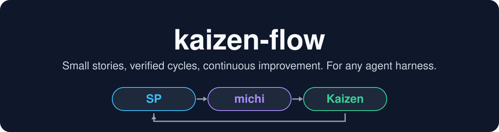
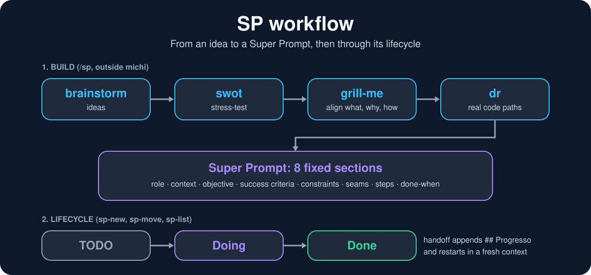
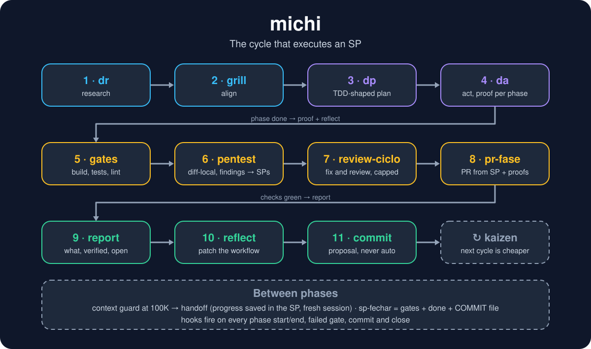
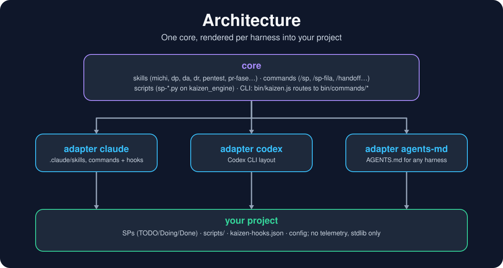
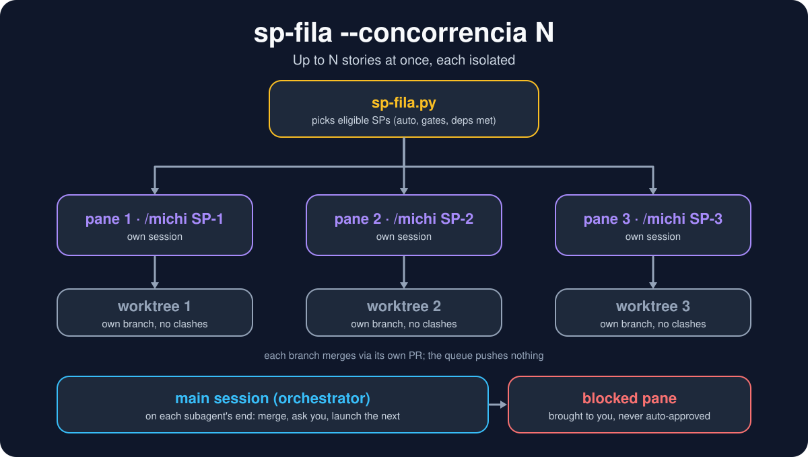

<p align="center">
  
</p>

<p align="center">
  
</p>

# kaizen-flow

<p align="center">
  <a href="https://github.com/BMSaiko/kaizen-flow/actions/workflows/ci.yml"></a>
  <a href="LICENSE"></a>
  = 18">
  <a href="https://www.npmjs.com/package/kaizen-flow"></a>
</p>

```bash
npx kaizen-flow --help      # or: npm i -g kaizen-flow && kaizen --help
```

A small workflow for working with coding agents:

- **SP** (Super Prompt): a user story in 8 fixed sections (role, context, objective, success criteria, constraints, seams, steps, done-when).
- **michi**: the cycle that executes an SP: research, plan (TDD-shaped), act, gates, report, reflect, commit proposal.
- **Kaizen**: every cycle ends with a reflect step, so the workflow gets cheaper and sharper each time.
- **Usage analysis**: tokens and API-equivalent cost per day, session, model and 5 h window, from your local transcripts (metrics only, never conversation content).

Works with **Claude Code** and **Codex CLI** (plus any harness that reads `AGENTS.md`). Node stdlib and Python stdlib only; no telemetry.

## Quickstart

Requirements: Node >= 18, Python 3.

```sh
git clone https://github.com/BMSaiko/kaizen-flow && cd kaizen-flow && npm link
cd your-project
kaizen init --harness codex                                             # or: claude | agents-md | opencode | cursor | gemini
python scripts/sp-new.py --project _default --slug login --priority P2   # write a story
kaizen usage --days 30                                                  # what it cost
```

Want to see the cycle first? `kaizen demo` runs it end to end in a throwaway folder (init, write an SP, gates, Done, report); `--keep` leaves the folder. Recording: [`docs/assets/demo.cast`](docs/assets/demo.cast) (play with `asciinema play`).

More detail in [Install](#install) and the [documentation](#documentation).

## Contents

- [Quickstart](#quickstart)
- [How it works](#how-it-works)
- [Why it uses fewer tokens and ships more](#why-it-uses-fewer-tokens-and-ships-more)
- [Install](#install)
- [Using it with Codex](#using-it-with-codex-codex-sets-up-the-codex-specific-parts)
- [Documentation](#documentation)
- [Known limits](#known-limits)
- [Contributing and license](#contributing-and-license)

## How it works

<p align="center">
  
</p>

<p align="center">
  
</p>

<p align="center">
  
</p>

<p align="center">
  
</p>

In parallel mode each story runs in its own terminal pane (up to 3 in total) with its own worktree and a status file; a watcher merges, brings questions and permission requests to you, and launches the next. No `Agent` subagents are used.

## Why it uses fewer tokens and ships more

An analysis of one author's own usage reports (Claude Code, 2026-10-15 to 2026-11-02, 19 days, one repo, API-equivalent cost):

- **380 SPs closed and 761 commits for $409.78**, about **$1.08 per SP** and $0.019 per request. Cost per SP fell from $1.77 in the first week to $1.11 in the second and $0.67 in the last five days.
- **Cache reads were 1,839M tokens against 11.6M of output**: almost all spend is re-reading stable context, not generating. Fixed SP sections and short rules keep that context small and cacheable.
- **Average context fell from 123K per request in the first week to about 80K per request from 2026-10-20 on** (inside michi cycles). The context guard (100K by default) stops sessions from growing until every request drags the whole history.

Why the workflow behaves this way:

1. **A fixed-shape SP replaces re-explaining.** Role, context, success criteria, constraints and done-when are written once; the agent does not ask or guess again mid-task.
2. **Research before action.** Searching the repo up front avoids the edit, break, re-read loop that burns the most tokens.
3. **TDD-shaped plan and gates.** "Done" is a test or visible proof, not the agent's opinion, so there is less rework and fewer "are you sure?" turns.
4. **Fresh-context handoff.** Progress is saved in the SP, then the session restarts clean. State lives in a file, not in a growing transcript.
5. **Reflect every cycle.** Each cycle trims the skills and rules that cost tokens without paying back (one pass cut a skill by 3.2 KB and disabled 10 unused skills), so cost per SP falls over time (see the numbers above).
6. **Measured, not guessed.** `kaizen usage` shows cost per SP, per day and per 5 h window, so a regression shows up in numbers.

### Why the 100K context guardrail matters

`context-guard.py` is a hook that reads the session transcript, warns at 85% of the limit (`KAIZEN_CONTEXT_LIMIT`, alias `CLAUDE_CONTEXT_LIMIT`, default 100000) and, at the limit, tells the agent to finish the current step and run the handoff. The reasons:

- **Cost grows with every request, not just with size.** Each request re-sends the whole context. A session at 200K pays about twice per request what one at 100K pays (the first-day average here was 205K), and it pays it on every remaining step, so cost per step climbs the longer a session runs.
- **Quality drops in long contexts.** Old tool output, abandoned approaches and stale file reads compete with the current task. The agent contradicts earlier decisions or re-reads what it already knew. A fresh context with a clean SP is sharper.
- **Compaction is lossy and unplanned.** Hitting the hard window forces an automatic summary at a moment you did not choose, possibly mid-edit. The guard acts early, at a step boundary, never in the middle of one.
- **The SP is the memory, not the transcript.** Because progress is written to the SP before the handoff, the new session starts from a few KB of state instead of 100K of history, and nothing important is lost.
- **It makes cost predictable.** A fixed ceiling bounds the worst-case price of a request, so one forgotten long session cannot dominate the bill.

The warning at 85% leaves room to finish the step cleanly. Raise or lower the limit with `KAIZEN_CONTEXT_LIMIT` to fit your model and budget. The guard also reads Codex rollouts (`event_msg` / `token_count`). On harnesses without hooks (`agents-md`, `opencode`, `cursor`, `gemini`, or Codex without the hook wired) the `AGENTS.md` block asks the agent to hand off by hand instead.

Caveat: this is one user's data with no controlled baseline (same tasks without the workflow), so read it as evidence of where tokens go, not as a benchmark. Run `kaizen usage` on your own project to check.

## Install

Requirements: Node >= 18, Python 3.

```sh
git clone <this repo> && cd kaizen-flow && npm link   # or: npx kaizen-flow ... once published
cd your-project
kaizen init --harness codex     # or: claude | agents-md | opencode | cursor | gemini
kaizen doctor --harness codex   # exits non-zero if something is missing
```

`init` never overwrites existing files: anything already there is kept and reported.

## Using it with Codex: Codex sets up the Codex-specific parts

The package ships a neutral core and an adapter per harness. For Codex, `kaizen init --harness codex` only drops the neutral material in the project:

- skills in `.agents/skills/`, prompts in `.kaizen/commands/`, helper scripts in `scripts/`;
- a marked block appended to `AGENTS.md` that tells the agent how the workflow works.

**Everything else that is specific to Codex is done by Codex itself**, in your project, on your machine: wiring the prompts into your Codex setup (`~/.codex/prompts`, `config.toml`, approvals and sandbox settings), and mapping Claude-only ideas (hooks, slash commands) to what your Codex version supports. This is deliberate: Codex knows its own installed version and configuration better than this repo can, and the repo does not edit files outside your project.

The easiest way is to let Codex do the install. Open Codex in your project and say:

> Install kaizen-flow for Codex: clone it, run `kaizen init --harness codex`, then read the `AGENTS.md` block it added and set up whatever is Codex-specific (prompts, config, approvals) for my setup. Finish with `kaizen doctor --harness codex`. The install is only complete when `kaizen doctor --harness codex` exits 0: while it does not, run `kaizen doctor --harness codex --fix` (restores what is missing, never overwrites) and re-run `doctor`, repeating until it exits 0. Then check that the handoff works in Codex (`/new` or equivalent); if it does not, fix it before declaring the install complete. Then tell me what you set up outside the project.

If you prefer to do it by hand, read `AGENTS.md` after `init` and follow the block.

## Documentation

| Doc | Contents |
|---|---|
| [Use cases](docs/use-cases.md) | "I want to..." recipes for install, usage, stories and handoff |
| [Term keys](docs/term.md) | Optional WezTerm shortcuts for `kaizen term` (menu and F2 table) |
| [Commands](docs/commands.md) | every `kaizen` command, option and workflow script |
| [Agent commands](docs/agent-commands.md) | `/sp`, `/michi`, `/sp-handoff`, `/sp-fila`, `/pentest`, `/review-ciclo`, `/pr-fase` and the michi cycle |
| [Tests](docs/testes.md) | `npm test`, test-command detection in `init`, the michi test phase (`sp-gates --testes`), CI and coverage |
| [Usage and cost](docs/usage-and-cost.md) | transcripts read, prices file, reports |
| [Config](docs/config.md) | `kaizen.config.json`, `kaizen-hooks.json` and project folders |
| [Handoff](docs/handoff.md) | fresh-context handoff, parallel panes, backends, CLI vs desktop app |
| [Privacy audit](docs/privacy-audit.md) | what `kaizen audit` scans for |
| [Error log](docs/error-log.md) | `kf_errlog`: JSONL log of script failures, location, fields, secret filtering |

## Known limits

- The Codex transcript parser follows the rollout format (`event_msg` / `token_count`, `last_token_usage`) and is tested with synthetic fixtures; if your Codex version logs usage differently, open an issue with an anonymised sample.
- `context-guard.py` measures Codex rollouts, but this repo does not wire Codex hooks it cannot verify on your version: point a Codex hook at `python -I scripts/context-guard.py` yourself (to verify on your version: the payload field with the rollout path; without it the guard uses the newest `rollout-*.jsonl` under `KAIZEN_CODEX_ROOT`, default `~/.codex/sessions`). `kaizen doctor --harness codex` reads `config.toml` (override with `--codex-config`) and says `ligado` or `degradado`; `agents-md` and unwired Codex fall back to the `AGENTS.md` block (handoff by hand).
- `opencode`, `cursor` and `gemini` have their own adapters (no context hook: handoff by hand). Cursor commands stay in `.kaizen/commands` because the Cursor commands path is not verified. Other harnesses use the `agents-md` fallback.
- The `new conversation` command used by the Codex handoff (`/new`) is an assumption to verify on your version.

## Contributing and license

Contributions are welcome: read [CONTRIBUTING](CONTRIBUTING.md) first (tests with `npm test`, `kaizen audit` clean, conventional commits). Released under the MIT license, see [LICENSE](LICENSE).
