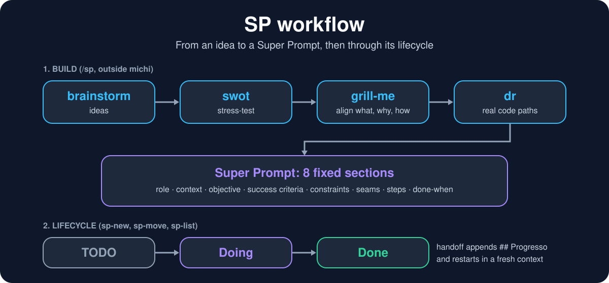
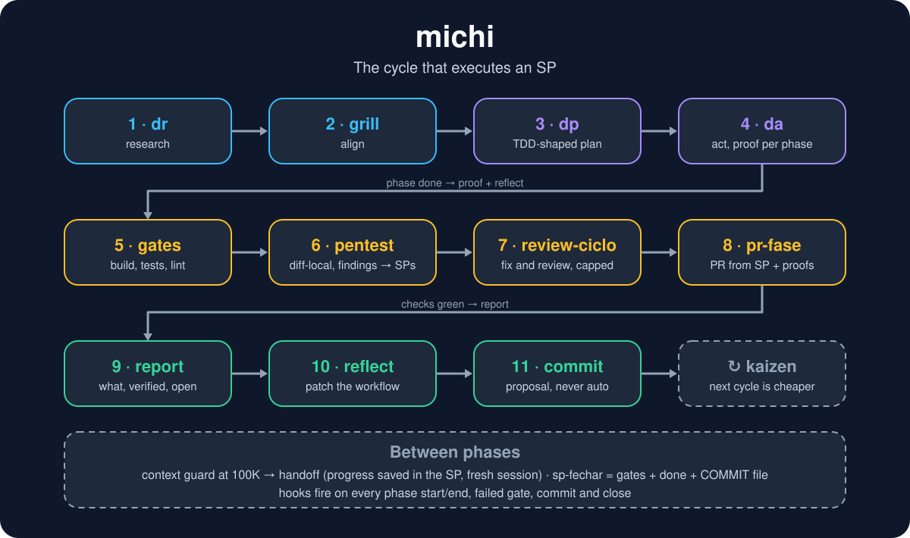

<p align="center">
  
</p>

<p align="center">
  
</p>

# kaizen-flow

A small workflow for working with coding agents:

- **SP** (Super Prompt): a user story in 8 fixed sections (role, context, objective, success criteria, constraints, seams, steps, done-when).
- **michi**: the cycle that executes an SP: research, plan (TDD-shaped), act, gates, report, reflect, commit proposal.
- **Kaizen**: every cycle ends with a reflect step, so the workflow gets cheaper and sharper each time.
- **Usage analysis**: tokens and API-equivalent cost per day, session, model and 5 h window, from your local transcripts (metrics only, never conversation content).

Works with **Claude Code** and **Codex CLI** (plus any harness that reads `AGENTS.md`). Node stdlib and Python stdlib only; no telemetry.

## How it works

<p align="center">
  
</p>

<p align="center">
  
</p>

## Why it uses fewer tokens and ships more

An analysis of one author's own usage reports (Claude Code, 2026-10-15 to 2026-10-22, one repo, API-equivalent cost):

- **91 SPs closed and 217 commits for $160.51**, about **$1.74 per SP** and $0.023 per request.
- **Cache reads were 751M tokens against 4.5M of output**: almost all spend is re-reading stable context, not generating. Fixed SP sections and short rules keep that context small and cacheable.
- **Average context 123K per request** inside michi cycles. The context guard (100K by default) stops sessions from growing until every request drags the whole history.

Why the workflow behaves this way:

1. **A fixed-shape SP replaces re-explaining.** Role, context, success criteria, constraints and done-when are written once; the agent does not ask or guess again mid-task.
2. **Research before action.** Searching the repo up front avoids the edit, break, re-read loop that burns the most tokens.
3. **TDD-shaped plan and gates.** "Done" is a test or visible proof, not the agent's opinion, so there is less rework and fewer "are you sure?" turns.
4. **Fresh-context handoff.** Progress is saved in the SP, then the session restarts clean. State lives in a file, not in a growing transcript.
5. **Reflect every cycle.** Each cycle trims the skills and rules that cost tokens without paying back (one pass cut a skill by 3.2 KB and disabled 10 unused skills), so cost per SP falls over time.
6. **Measured, not guessed.** `kaizen usage` shows cost per SP, per day and per 5 h window, so a regression shows up in numbers.

### Why the 100K context guardrail matters

`context-guard.py` is a hook that reads the session transcript, warns at 85% of the limit (`CLAUDE_CONTEXT_LIMIT`, default 100000) and, at the limit, tells the agent to finish the current step and run the handoff. The reasons:

- **Cost grows with every request, not just with size.** Each request re-sends the whole context. A session at 200K pays about twice per request what one at 100K pays, and it pays it on every remaining step, so cost per step climbs the longer a session runs.
- **Quality drops in long contexts.** Old tool output, abandoned approaches and stale file reads compete with the current task. The agent contradicts earlier decisions or re-reads what it already knew. A fresh context with a clean SP is sharper.
- **Compaction is lossy and unplanned.** Hitting the hard window forces an automatic summary at a moment you did not choose, possibly mid-edit. The guard acts early, at a step boundary, never in the middle of one.
- **The SP is the memory, not the transcript.** Because progress is written to the SP before the handoff, the new session starts from a few KB of state instead of 100K of history, and nothing important is lost.
- **It makes cost predictable.** A fixed ceiling bounds the worst-case price of a request, so one forgotten long session cannot dominate the bill.

The warning at 85% leaves room to finish the step cleanly. Raise or lower the limit with `CLAUDE_CONTEXT_LIMIT` to fit your model and budget. On harnesses without hooks (Codex, `agents-md`) the `AGENTS.md` block asks the agent to hand off by hand instead.

Caveat: this is one user's data with no controlled baseline (same tasks without the workflow), so read it as evidence of where tokens go, not as a benchmark. Run `kaizen usage` on your own project to check.

## Install

Requirements: Node >= 18, Python 3.

```sh
git clone <this repo> && cd kaizen-flow && npm link   # or: npx kaizen-flow ... once published
cd your-project
kaizen init --harness codex     # or: claude | agents-md
kaizen doctor --harness codex   # exits non-zero if something is missing
```

`init` never overwrites existing files: anything already there is kept and reported.

## Using it with Codex: Codex sets up the Codex-specific parts

The package ships a neutral core and an adapter per harness. For Codex, `kaizen init --harness codex` only drops the neutral material in the project:

- skills in `.agents/skills/`, prompts in `.kaizen/commands/`, helper scripts in `scripts/`;
- a marked block appended to `AGENTS.md` that tells the agent how the workflow works.

**Everything else that is specific to Codex is done by Codex itself**, in your project, on your machine: wiring the prompts into your Codex setup (`~/.codex/prompts`, `config.toml`, approvals and sandbox settings), and mapping Claude-only ideas (hooks, slash commands) to what your Codex version supports. This is deliberate: Codex knows its own installed version and configuration better than this repo can, and the repo does not edit files outside your project.

The easiest way is to let Codex do the install. Open Codex in your project and say:

> Install kaizen-flow for Codex: clone it, run `kaizen init --harness codex`, then read the `AGENTS.md` block it added and set up whatever is Codex-specific (prompts, config, approvals) for my setup. Finish with `kaizen doctor --harness codex`. The install is only complete when `kaizen doctor --harness codex` exits 0: while it does not, run `kaizen doctor --harness codex --fix` (restores what is missing, never overwrites) and re-run `doctor`, repeating until it exits 0. Then check that the handoff works in Codex (`/new` or equivalent); if it does not, fix it before declaring the install complete. Then tell me what you set up outside the project.

If you prefer to do it by hand, read `AGENTS.md` after `init` and follow the block.

## Documentation

| Doc | Contents |
|---|---|
| [Use cases](docs/use-cases.md) | "I want to..." recipes for install, usage, stories and handoff |
| [Commands](docs/commands.md) | every `kaizen` command, option and workflow script |
| [Agent commands](docs/agent-commands.md) | `/sp`, `/michi`, `/sp-handoff`, `/sp-fila`, `/pentest`, `/review-ciclo`, `/pr-fase` and the michi cycle |
| [Usage and cost](docs/usage-and-cost.md) | transcripts read, prices file, reports |
| [Config](docs/config.md) | `kaizen.config.json`, `kaizen-hooks.json` and project folders |
| [Handoff](docs/handoff.md) | fresh-context handoff, parallel panes, backends, CLI vs desktop app |
| [Privacy audit](docs/privacy-audit.md) | what `kaizen audit` scans for |

Quickstart:

```sh
kaizen init --harness codex
python scripts/sp-new.py --project _default --slug login --priority P2   # write a story
kaizen usage --days 30                                                  # what it cost
```

## Known limits

- The Codex transcript parser follows the rollout format (`event_msg` / `token_count`, `last_token_usage`) and is tested with synthetic fixtures; if your Codex version logs usage differently, open an issue with an anonymised sample.
- Codex and `agents-md` run without the context-guard hook (degraded on purpose: `context-guard.py` only reads Claude transcripts and this repo does not wire Codex hooks it cannot verify on your version). The `AGENTS.md` block tells the agent to run the handoff by hand when the context gets long, and `kaizen doctor` prints that notice. If your Codex version has hooks, you can point one at a script that reads its rollout; contributions welcome.
- Cursor, Gemini CLI, opencode and similar are supported only through the `agents-md` fallback.
- The `new conversation` command used by the Codex handoff (`/new`) is an assumption to verify on your version.

## License

MIT. See [LICENSE](LICENSE) and [CONTRIBUTING](CONTRIBUTING.md).
